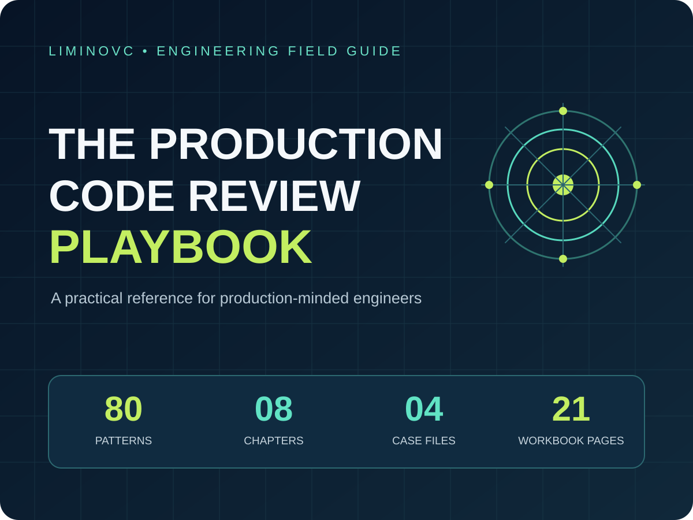
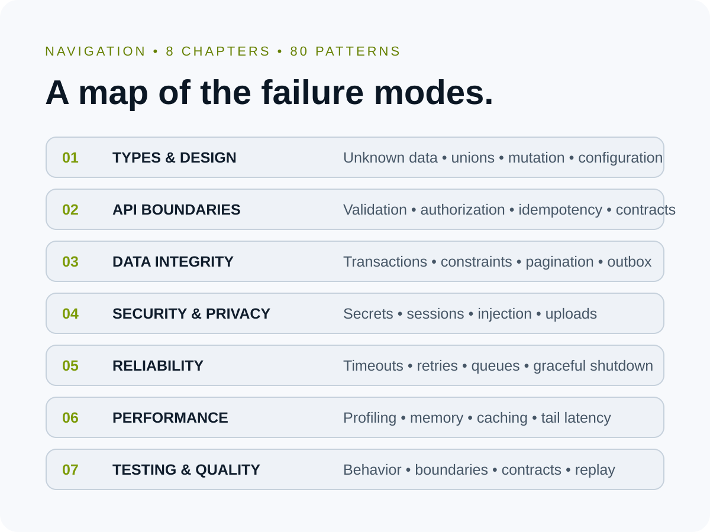
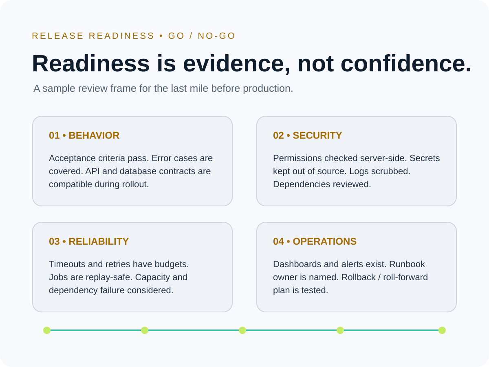

# The Production Code Review Playbook

**A practical engineering field guide for more consistent production code reviews — with TypeScript, Node.js and PostgreSQL in view.**

[**Get the complete playbook on Gumroad →**](https://luminovc.gumroad.com/l/angcrg)

> This GitHub repository is a public product overview and preview. The complete playbook is a paid digital PDF; the full document is not included here.

## Review production code with a repeatable system

Code review is more than checking formatting or whether a pull request passes tests. Reviewers also need to reason about boundaries, data integrity, security, reliability, performance, testing and operational readiness.

The **Production Code Review Playbook** organizes those concerns into a practical reference:

- **80 practical code-review patterns**
- **8 focused chapters**
- **4 sourced incident case files**
- **21 guided workbook pages**
- Coverage framed around **TypeScript, Node.js and PostgreSQL**

It is designed to help engineers make review conversations more concrete: identify a failure mode, look for the relevant evidence, and apply a review rule that is appropriate to the system being changed.

## What is inside

| Chapter | Review area | Topics shown in the playbook |
|---|---|---|
| 01 | Types & Design | Unknown data, unions, mutation, configuration |
| 02 | API Boundaries | Validation, authorization, idempotency, contracts |
| 03 | Data Integrity | Transactions, constraints, pagination, outbox |
| 04 | Security & Privacy | Secrets, sessions, injection, uploads |
| 05 | Reliability | Timeouts, retries, queues, graceful shutdown |
| 06 | Performance | Profiling, memory, caching, tail latency |
| 07 | Testing & Quality | Behavior, boundaries, contracts, replay |
| 08 | Delivery & Operability | CI, migrations, telemetry, rollback |

## A sample of the approach

The sample release-readiness page frames production readiness around evidence in four areas:

- **Behavior:** acceptance criteria pass, error cases are covered, and API/database contracts are compatible during rollout.
- **Security:** permissions are checked server-side, secrets are excluded from source, logs are scrubbed, and dependencies are reviewed.
- **Reliability:** timeout and retry budgets are considered, jobs are replay-safe, and capacity or dependency failure is addressed.
- **Operations:** dashboards and alerts exist, a runbook owner is named, and rollback or roll-forward is planned and tested.

These are sample topics from the playbook, not a substitute for reviewing the complete guide.

## Who this is for

- Backend and full-stack engineers working on production systems
- Tech leads and senior reviewers
- Engineering teams reviewing TypeScript and Node.js services
- Teams using PostgreSQL and transactional data workflows
- Engineers who want a more structured review and release-readiness reference

## Why get the complete playbook?

The public previews show the structure and a small sample. The paid PDF brings the complete set together in one organized reference:

1. **Breadth:** eight review areas instead of focusing only on style or tests.
2. **Practicality:** 80 patterns organized around recognizable production failure modes.
3. **Context:** four sourced incident case files to connect review decisions with real incident lessons.
4. **Practice:** 21 workbook pages for guided application and discussion.

If you regularly review production code, the complete playbook gives you one structured reference to work through rather than assembling a checklist from scattered notes.

## Get the complete PDF

[**View The Production Code Review Playbook on Gumroad →**](https://luminovc.gumroad.com/l/angcrg)

Checkout: https://luminovc.gumroad.com/l/angcrg

## Important notes

- This repository contains a product description and watermarked preview images only.
- The complete paid PDF is not included in this repository.
- This is a human code-review and engineering reference, not an automated static-analysis tool, scanner, CI action or security certification.
- The patterns are prompts for engineering judgment; adapt them to your architecture, threat model and operational context.

---

**Published by LIMINOVC** · [Gumroad product page](https://luminovc.gumroad.com/l/angcrg)

## Search topics

Production code review, software engineering, TypeScript, Node.js, PostgreSQL, secure coding, code quality, engineering best practices, API design, data integrity, application security, reliability engineering, performance engineering, software testing, DevOps, release engineering, incident analysis, backend development and production readiness.
